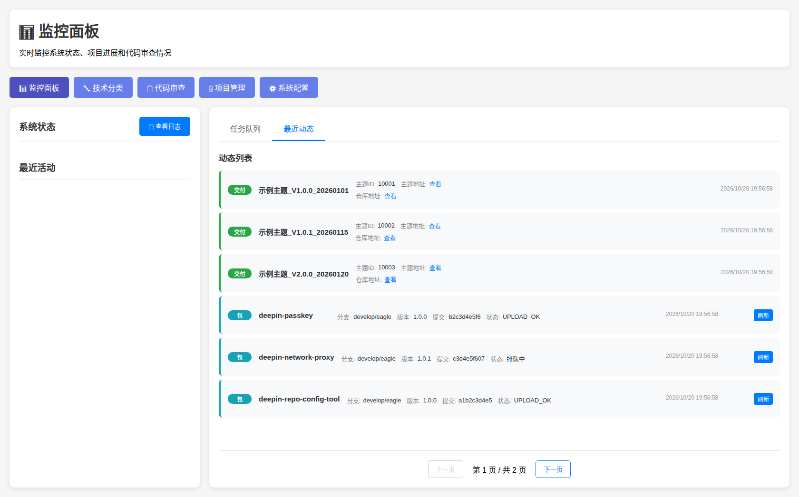
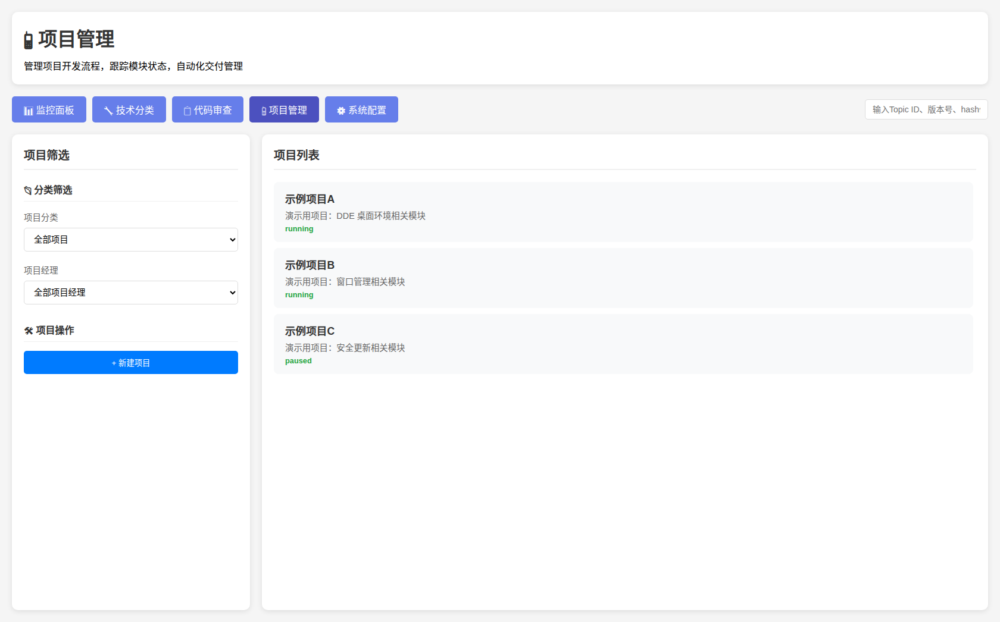
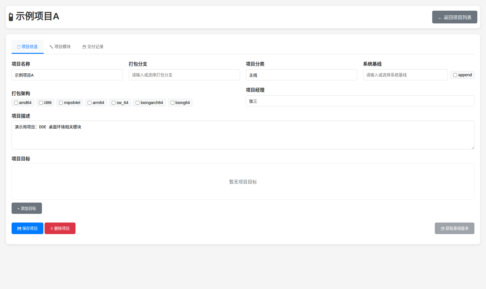
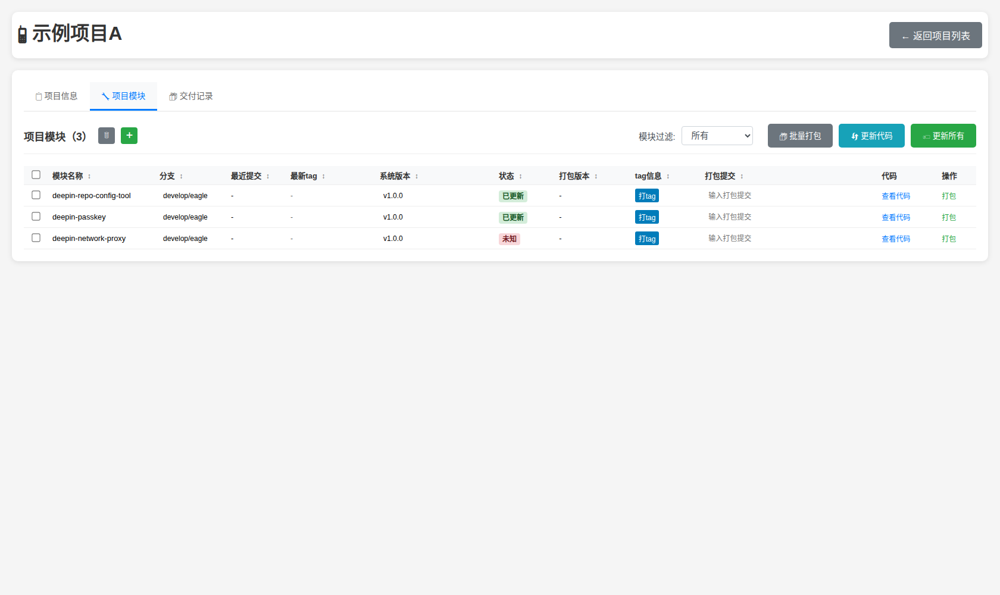
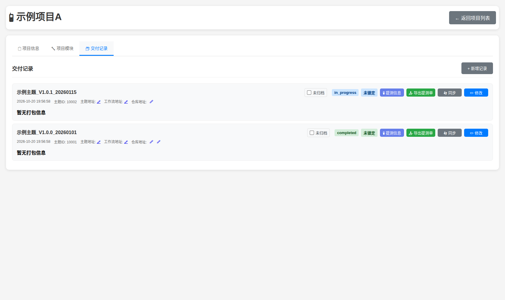
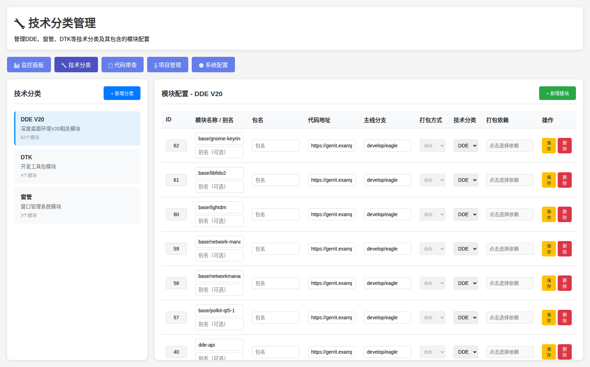
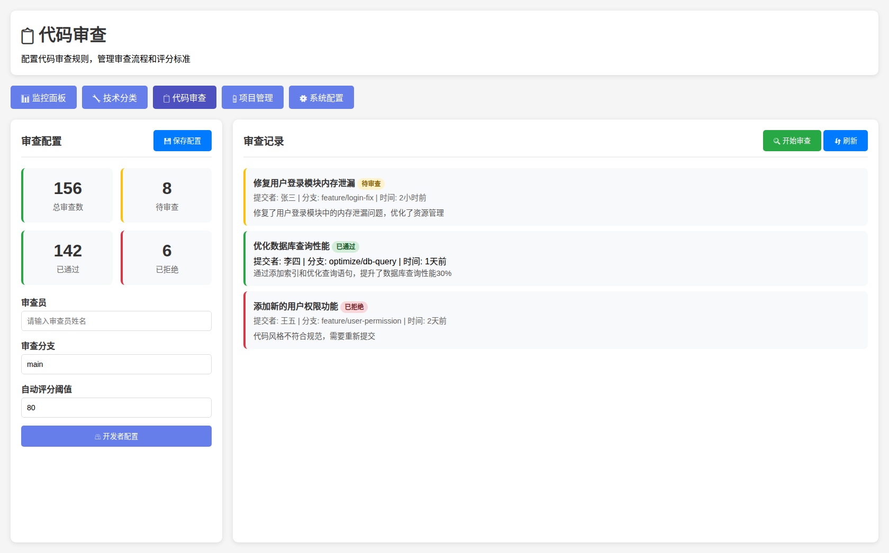
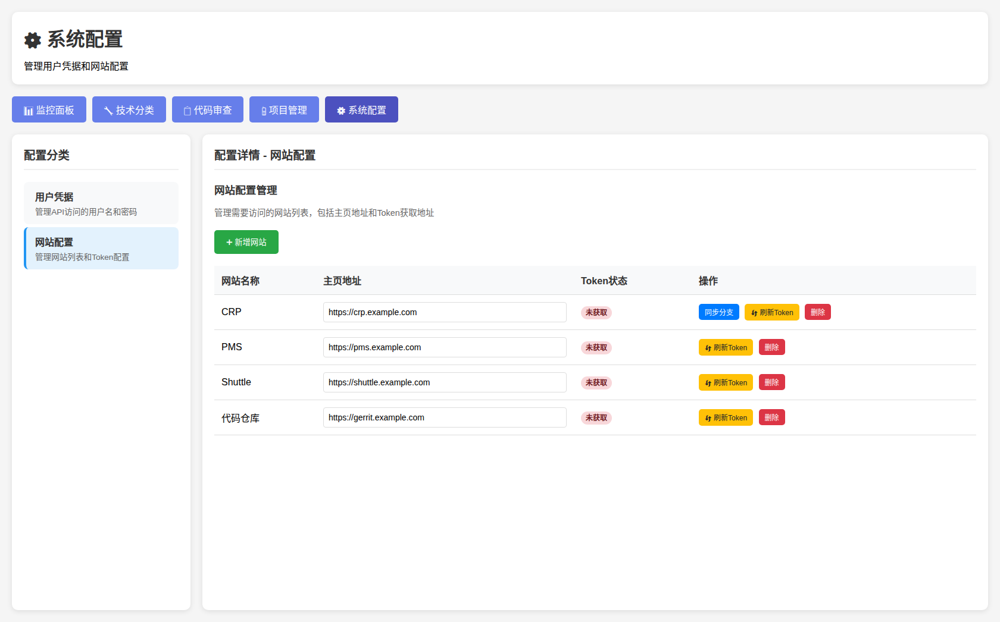

# 研发自动化管理平台

一个现代化的研发自动化管理平台，旨在提高开发团队的协作效率和项目管理能力。

## 🖼 界面截图

> 以下截图使用演示数据（`example.com` 域名），不含任何真实内网地址与业务数据。

| 监控面板 | 项目管理 |
| --- | --- |
|  |  |

| 项目详情 · 项目信息 | 项目详情 · 项目模块 |
| --- | --- |
|  |  |

| 项目详情 · 交付记录（同步按钮带「同步中」状态，防重复点击） | 技术分类 |
| --- | --- |
|  |  |

| 代码审查 | 系统配置 · 网站配置 |
| --- | --- |
|  |  |

## 🚀 快速开始

### 环境要求
- PHP 8.0+
- MySQL 8.0+
- Web服务器 (Apache/Nginx) 或 PHP内置服务器

### 安装步骤

1. **克隆项目**
   ```bash
   git clone <repository-url>
   cd localhost
   ```

2. **配置数据库**
   ```bash
   # 创建数据库
   mysql -u root -p
   CREATE DATABASE dev_automation CHARACTER SET utf8mb4 COLLATE utf8mb4_unicode_ci;
   ```

3. **导入数据库结构**
   ```bash
   mysql -u root -p dev_automation < src/database/init.sql
   mysql -u root -p dev_automation < src/database/config_tables.sql
   ```

4. **配置数据库连接**
   复制示例配置并填写自己的信息（不要直接改被版本管理的文件）：
   ```bash
   # 可选，也可以用环境变量 DB_HOST / DB_PORT / DB_NAME / DB_USER / DB_PASSWORD
   cat > src/config/database.local.php <<'PHP'
   <?php
   return [
       'host'     => '127.0.0.1',
       'port'     => 3306,
       'database' => 'dev_automation',
       'username' => 'dev_user',
       'password' => '你的密码',
   ];
   PHP
   ```

5. **配置外部系统地址**
   ```bash
   # 覆盖 CRP / Gerrit / PMS / Shuttle / 明道云 / 软件源 的地址（默认是 example.com 占位）
   cat > src/config/endpoints.local.php <<'PHP'
   <?php
   return [
       'crp'         => 'https://crp.your-company.com',
       'gerrit'      => 'https://gerrit.your-company.com',
       'pms'         => 'https://pms.your-company.com',
       'shuttle'     => 'https://shuttle.your-company.com',
       'cooperation' => 'https://cooperation.your-company.com',
       'pools'       => 'https://pools.your-company.com',
   ];
   PHP
   ```

   CRP 的 JWT token 通过配置页面填写，会保存到 `src/config/crp_config.local.php`（已 gitignore），
   也可以用环境变量 `CRP_JWT_TOKEN` 注入。

6. **启动服务器**
   ```bash
   # 方法1: 使用启动脚本（推荐）
   ./start_server.sh
   
   # 方法2: 手动启动（通过IP访问）
   php -S 0.0.0.0:8000 -t public
   ```

6. **重启服务**
   ```bash
   # 停止当前服务 (Ctrl+C)
   # 然后重新启动
   php -S 0.0.0.0:8000 -t public
   
   # 或者使用后台运行
   nohup php -S 0.0.0.0:8000 -t public > server.log 2>&1 &
   
   # 停止后台服务
   pkill -f "php -S 0.0.0.0:8000"
   ```

7. **访问应用**
   - 本地访问：`http://localhost:8000`
   - IP访问：`http://你的IP地址:8000`（如：`http://你的服务器IP:8000`）

8. **检查网络访问**（可选）
   ```bash
   # 检查服务状态和可用的访问地址
   ./check_network_access.sh
   ```

## 📁 项目结构

```
localhost/
├── docs/                    # 文档目录
│   ├── README.md           # 项目说明
│   ├── ARCHITECTURE.md     # 架构设计文档
│   └── DEPLOYMENT.md       # 部署文档
├── src/                    # 源代码目录
│   ├── api/               # API接口
│   ├── pages/             # 页面文件
│   ├── config/            # 配置文件
│   ├── database/          # 数据库文件
│   └── assets/            # 静态资源
│       ├── css/           # 样式文件
│       └── js/            # JavaScript文件
├── public/                # 公共访问目录
│   └── index.php          # 主入口文件
├── docker-compose.yml     # Docker配置
├── composer.json          # PHP依赖
└── package.json           # Node.js依赖
```

## 🎯 主要功能

- **技术分类管理**: 创建和管理技术分类，为每个分类添加模块
- **项目管理**: 项目创建和配置，项目状态监控
- **交付记录管理**: 创建、编辑、同步和删除交付记录，支持关联数据管理
- **代码审查**: 自动评分配置，代码质量检查
- **代码更新管理**: 根据代码分支获取最新提交，更新build_commit字段，支持批量更新所有模块
- **系统配置**: 用户凭证管理，网站配置管理，Token自动刷新
- **监控面板**: 系统状态监控，性能指标展示

## 🛠 技术栈

- **后端**: PHP 8.0+
- **数据库**: MySQL 8.0+
- **前端**: HTML5, CSS3, JavaScript (ES6+)
- **UI框架**: Bootstrap 5
- **图标**: Font Awesome 6
- **容器化**: Docker & Docker Compose

## 📚 文档

- [项目说明](docs/README.md) - 详细的项目介绍和功能说明
- [架构设计](docs/ARCHITECTURE.md) - 系统架构和技术设计
- [部署指南](docs/DEPLOYMENT.md) - 详细的部署和配置说明
- [网络访问配置](docs/NETWORK_ACCESS.md) - 通过IP地址访问配置指南
- [数据库升级](docs/DATABASE_UPGRADE.md) - 数据库升级和迁移指南

## 🔧 开发

### 开发环境设置
```bash
# 安装依赖
composer install
npm install

# 启动开发服务器（通过IP访问）
php -S 0.0.0.0:8000 -t public

# 重启开发服务器
# 方法1: 停止当前服务 (Ctrl+C) 然后重新启动
php -S 0.0.0.0:8000 -t public

# 方法2: 后台运行
nohup php -S 0.0.0.0:8000 -t public > server.log 2>&1 &

# 停止后台服务
pkill -f "php -S 0.0.0.0:8000"
```

### 代码规范
- 遵循 PSR-4 自动加载规范
- 遵循 PSR-12 代码风格规范
- 使用统一的命名约定

## 🚀 部署

### 使用Docker
```bash
docker-compose up -d
```

### 使用Apache/Nginx
请参考 [部署文档](docs/DEPLOYMENT.md) 中的详细说明。

## 🔐 敏感信息与本地配置

仓库里**不包含任何真实凭据、内网地址或业务数据**，所有与环境相关的内容都放在被 `.gitignore` 忽略的本地文件里：

| 文件 | 用途 | 覆盖方式 |
|------|------|----------|
| `src/config/database.local.php` | 数据库账号密码 | 或环境变量 `DB_HOST` / `DB_PORT` / `DB_NAME` / `DB_USER` / `DB_PASSWORD` |
| `src/config/endpoints.local.php` | CRP / Gerrit / PMS / Shuttle / 明道云 / 软件源 地址 | 或环境变量 `CRP_BASE_URL` / `GERRIT_BASE_URL` / `PMS_BASE_URL` / `SHUTTLE_BASE_URL` / `COOPERATION_BASE_URL` / `POOLS_BASE_URL` |
| `src/config/crp_config.local.php` | CRP JWT token、默认主题负责人 | 或环境变量 `CRP_JWT_TOKEN` / `CRP_DEFAULT_OWNER`；配置页面保存时写入该文件 |

代码中的地址统一通过 `app_endpoint('crp')` 或 `CRP_API` / `GERRIT_BASE` / `PMS_BASE` / `SHUTTLE_BASE` /
`COOPERATION_API` / `POOLS_BASE` 常量获取（见 `src/lib/endpoints.php`），默认值都是 `*.example.com` 占位。

另外，导出提测单需要自备模板：把 xlsx 模板放到 `src/config/提测模板.xlsx`（该文件因含内部模板内容未随仓库分发）。

## 🧩 项目管理

- 项目管理页的搜索框支持按 **Topic ID、版本号、commit hash、仓库地址** 模糊搜索项目。

## 🤝 贡献

欢迎提交 Issue 和 Pull Request！

## 📄 许可证

MIT License

## 📞 支持

如果遇到问题，请：
1. 查看 [文档](docs/)
2. 提交 [Issue](../../issues)
3. 联系技术支持 